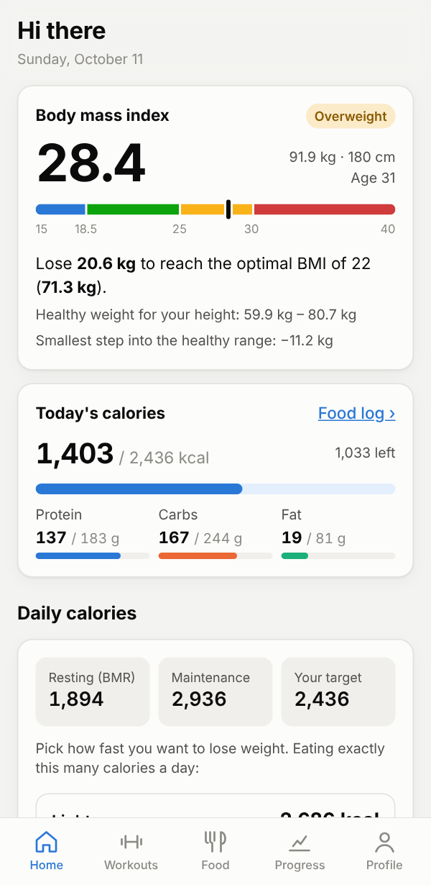
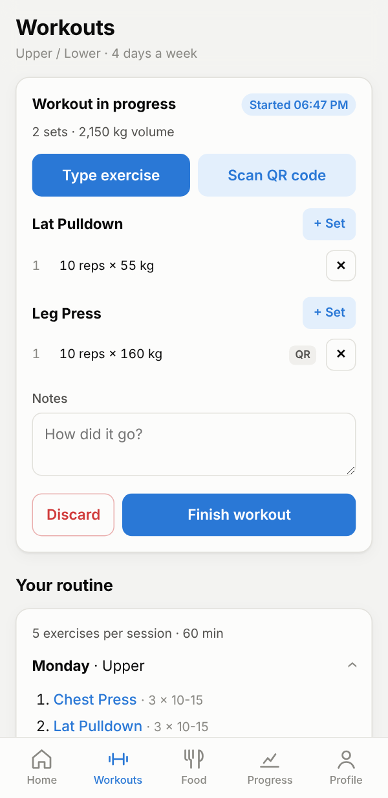
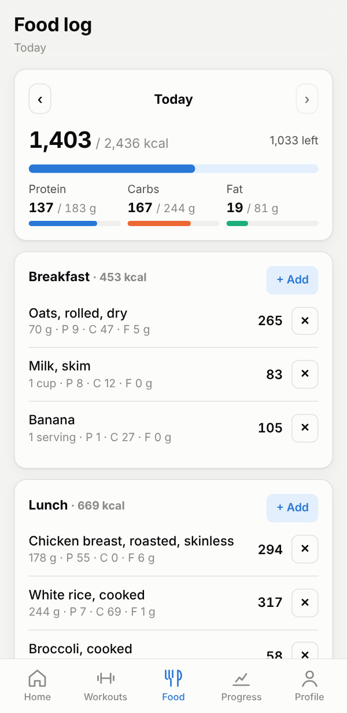
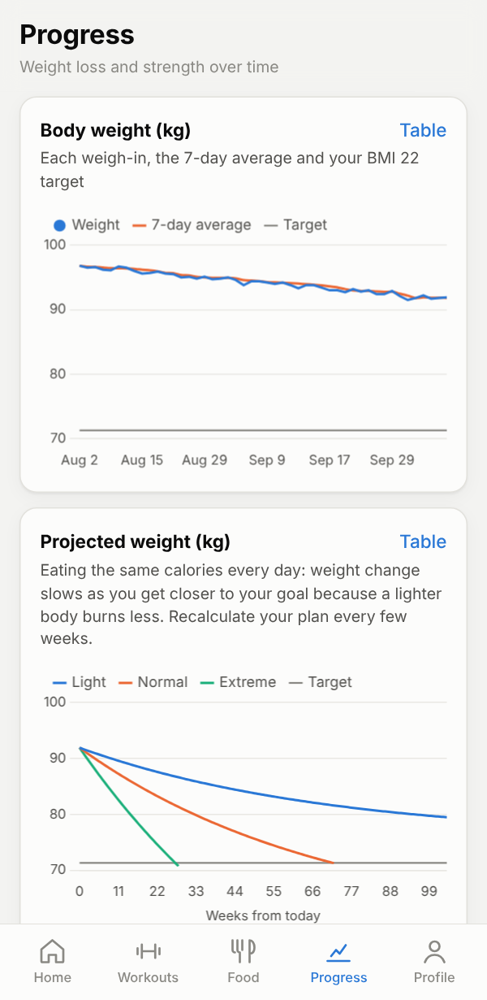

# Fitness App

Sign up, get your BMI, daily calories and a workout plan, then log workouts, food and body measurements and watch your progress on charts.

The backend is **FastAPI + SQLModel**. The screens in `app/static/` are a **web preview of the mobile app**: they run in any browser, phone-sized, and use the same API the mobile app will use. The design is in [ARCHITECTURE.md](ARCHITECTURE.md).

| Home | Workouts | Food | Progress |
|---|---|---|---|
|  |  |  |  |

## Run it on your PC

You need [uv](https://docs.astral.sh/uv/) (it installs Python 3.13 and all packages for you) and git.

**1. Install uv** (once)

Windows (PowerShell):
```powershell
powershell -ExecutionPolicy ByPass -c "irm https://astral.sh/uv/install.ps1 | iex"
```
macOS / Linux:
```bash
curl -LsSf https://astral.sh/uv/install.sh | sh
```
Close and reopen the terminal afterwards.

**2. Get the code**
```bash
git clone https://github.com/EyadAlayed506/fastapi_tutorial.git
cd fastapi_tutorial
git checkout claude/keen-dirac-t5f0tk
cd fitness_app
```

**3. Install, add demo data, start**
```bash
uv sync
uv run python -m app.demo
uv run fastapi dev app/main.py
```

**4. Open http://localhost:8000** and log in with **demo@fitness.app / demo1234**, or sign up with your own email.

The demo account has ten weeks of weigh-ins, workouts, food logs and measurements, so every chart has data. Running `uv run python -m app.demo` again resets it.

Also useful:
- **http://localhost:8000/docs** – interactive API documentation (try every endpoint).
- `uv run pytest` – run the tests.
- Stop the server with `Ctrl+C`.

## What works

| Area | What you can do |
|---|---|
| Account | Sign up (with an "email me ads and discounts" checkbox), log in, delete account |
| Profile | Birth date, sex, height, weight, activity level, goal, diet, training days, minutes per session, equipment, kg/cm or lb/in |
| Health plan | BMI + category, healthy weight range, kg to lose/gain for BMI 22, resting and maintenance calories, light / normal / extreme diet with calorie difference, kg per week and weeks to goal |
| Routine | Workout plan built from your days per week, minutes per session, equipment and goal |
| Workouts | Start a workout, add exercises by **typing the name** (typos are fine) or **scanning the machine's QR code**, log reps, weight (kg or lb), RPE, rest and notes |
| QR stickers | Workouts tab → "Print QR stickers" shows a printable code for every machine |
| Food | Search the built-in list, **USDA FoodData Central** and **Open Food Facts**; units change with the food (g/kg/oz/lb for solids, ml/l/cup/gallon… for drinks, or servings); create custom foods by hand with all macros and sub-macros |
| Progress | Weight trend, projected weight per diet option, calories vs target, macros, lift progress (estimated 1RM), weekly volume per body region, month-to-month body measurements with body-fat estimate |
| Emails | Opt in/out in the Profile tab; every user has a one-click unsubscribe link (`/api/marketing/unsubscribe/{token}`) |

**Scanning QR codes:** on a PC with a webcam it works at `http://localhost:8000`. To test, open the QR sticker page on your phone and hold it up to the webcam, or type the code printed under the sticker (e.g. `leg-press`).

**Using it from your phone:** start the server with `uv run fastapi dev app/main.py --host 0.0.0.0`, then open `http://<your-PC's-IP>:8000` on a phone on the same Wi-Fi. Browsers only allow the camera on `localhost` or HTTPS, so on the phone type the QR code instead (the real mobile app will not have this limit).

## Settings

Copy `.env.example` to `.env` to change settings:

| Setting | Default | Notes |
|---|---|---|
| `DATABASE_URL` | `sqlite:///./fitness.db` | A file next to the app. PostgreSQL works too (needs `uv add "psycopg[binary]"`) |
| `JWT_SECRET` | a development value | **Change it** before putting the app online |
| `JWT_EXPIRE_MINUTES` | `30` | How long a login lasts |
| `USDA_API_KEY` | `DEMO_KEY` | `DEMO_KEY` allows only a few searches per hour. Get a free key at https://api.data.gov/signup/ |
| `OFF_USER_AGENT` | `FitnessApp/0.1 (...)` | Open Food Facts asks apps to identify themselves |

## Project layout

```
fitness_app/
├── app/
│   ├── main.py          # FastAPI app; serves the API under /api and the web preview at /
│   ├── config.py        # settings from .env
│   ├── database.py      # engine and session
│   ├── security.py      # password hashing (Argon2) and login tokens (JWT)
│   ├── deps.py          # CurrentUser / CurrentProfile dependencies
│   ├── models/          # SQLModel tables and request/response schemas
│   ├── routers/         # one file per area: auth, me, exercises, workouts, foods, measurements, analytics, marketing
│   ├── services/        # formulas, routine generator, units, food search, QR codes
│   ├── seed/            # starter machine catalogue (48 exercises) and 38 common foods
│   ├── static/          # web preview (HTML, CSS, JS, Chart.js)
│   └── demo.py          # demo account
└── tests/               # 49 tests: formulas, units, routine, every API area
```

Not built yet (see the build phases in ARCHITECTURE.md): image features, sending marketing emails (provider not chosen), database migrations, the native mobile app.

The calculations are standard estimates (Mifflin–St Jeor, 7,700 kcal per kg, Epley, U.S. Navy body fat), not medical advice.
